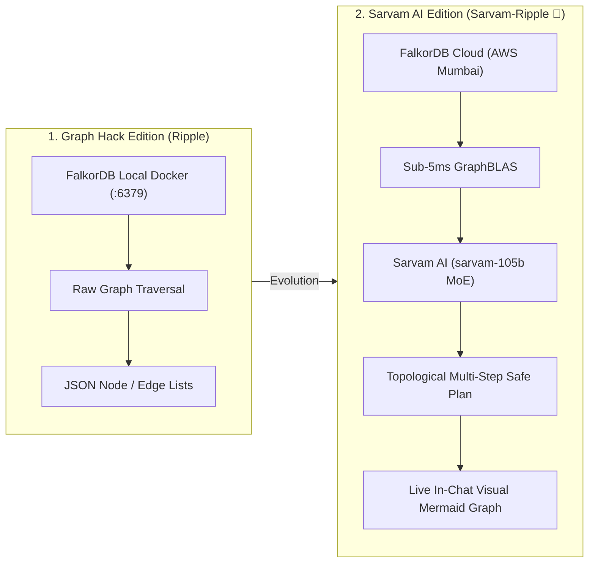

<div align="center">
  
  <h1>Ripple & Sarvam-Ripple</h1>
  <p><strong>FalkorDB-Powered Dependency Graph & Sarvam AI Architectural Guardian for AI Coding Agents</strong></p>
  <p>
    <em>Conceived & Created by <strong>Trivikram Kalagi</strong></em>
  </p>
  <p>
    <a href="https://sarvam-ripple.vercel.app"><strong>🌐 Sarvam AI Edition (2nd Prize 🥈)</strong></a> &bull;
    <a href="https://ripple-graph.vercel.app"><strong>🌐 Original Graph Hack Edition</strong></a> &bull;
    <a href="https://github.com/trivikramkalagi91-commits/Ripple"><strong>GitHub Repository</strong></a> &bull;
    <a href="https://www.falkordb.com/"><strong>FalkorDB</strong></a> &bull;
    <a href="https://www.sarvam.ai/"><strong>Sarvam AI</strong></a>
  </p>
</div>

---

### 🏆 Hackathon Honors & Editions Overview

Both editions of this project were conceived, designed, and developed by **Trivikram Kalagi**, evolving across two competitive hackathons to solve the biggest problem in autonomous AI software engineering: **agents editing code in the dark**.

| Edition | Hackathon Event | Recognition | Live Deployment | Core Innovation |
| :--- | :--- | :--- | :--- | :--- |
| **Sarvam-Ripple** *(Latest)* | **Build with Sarvam AI Hackathon** (REVA University, Nov 2026) | 🥈 **2nd Prize Winner** (1st Runner Up) | [**sarvam-ripple.vercel.app**](https://sarvam-ripple.vercel.app) | **Sarvam-105B MoE Safe Planner** + **FalkorDB Cloud** + In-Chat Color Mermaid + 1-Click Autonomous Agent Setup |
| **Ripple** *(Original)* | **Graph Hack / FalkorDB Hackathon** (Oct 2026) | Featured Project | [**ripple-graph.vercel.app**](https://ripple-graph.vercel.app) | **FalkorDB GraphBLAS Engine** + Sub-5ms Multi-Hop Traversals + Shortest Import Path & Hotspot Detection |

---

## ⚡ What was Updated in the Sarvam AI Version? (Key Differences)

The original **Ripple** gave AI agents raw mathematical graph queries (nodes and edges). **Sarvam-Ripple** upgraded this into an **Autonomous Architectural Guardian**:



### Detailed Upgrade Comparison

| Feature / Capability | Original Graph Hack Edition (`ripple`) | Upgraded Sarvam AI Edition (`sarvam-ripple` 🥈) |
| :--- | :--- | :--- |
| **AI Reasoning Layer** | ❌ None (Returned raw Cypher query results) | ✅ **Sarvam AI (`sarvam-105b`) MoE**: Analyzes affected code diffs and writes step-by-step refactor plans |
| **Flagship MCP Tool** | `blast_radius`, `why_affected` | ✅ **`generate_safe_plan`**: Combines FalkorDB graph traversal with Sarvam AI reasoning in 1 tool call |
| **Database Deployment** | Local Docker required (`localhost:6379`) | ✅ **FalkorDB Cloud** (AWS Mumbai `ap-south-1`) with zero local Docker dependency + automatic fallback |
| **Visual In-Chat Graph** | Text-only JSON/tables | ✅ **Dynamic Color-Coded Mermaid Diagram**: Green (Target), Red (Hop 1), Orange (Hop 2), Yellow (Hop 3), White (Hop 4) |
| **Agent Setup Experience** | Manual CLI build & configuration | ✅ **1-Click Agent Setup Prompt**: Paste 1 prompt into Cursor/Antigravity for autonomous install & indexing |
| **AST Alias Resolution** | Basic file imports | ✅ Enhanced `ts-morph` AST parser resolving `@/*` tsconfig path aliases and barrel `index.ts` re-exports |
| **Frontend & Design** | Standard dark theme | ✅ Editorial **Google Stitch Theme**: Warm `#faf9f6` canvas, `Newsreader` + `Inter` typography, 3D Rubik's cube mascot |

---

## 🚨 The Problem: AI Coding Agents Break Code in the Dark

When modern AI coding agents (Claude, Cursor, Copilot, Antigravity) and **"Vibecoders"** edit or refactor code in medium-to-large repositories, they operate with dangerous **tunnel vision**. A single change to an exported function, interface, or shared utility silently breaks downstream consumers 2, 3, or 4 hops away.

Plain text search and `grep` fail completely:
- **Barrel re-exports** (`export * from './...'`) mask true dependency chains.
- **Path aliases** (`@/components`, `~/utils`) hide actual file paths on disk.
- **Common identifier names** (`id`, `user`, `status`) return hundreds of false-positive grep matches.
- **No topological ordering**: AI assistants don't know which order to edit files to avoid cascading build breakages.

---

## ⚡ The Solution: Sarvam-Ripple Architecture

Sarvam-Ripple pairs **FalkorDB's** sub-5ms graph traversals with **Sarvam AI's** deep architectural reasoning over the **Model Context Protocol (MCP)**:


---

## ⚡ 1-Click Agent Setup Prompt (Copy & Paste Into Your AI Agent)

> **💡 Zero Manual Setup:** Copy the prompt below and paste it directly into your AI coding assistant (Cursor, Claude Desktop, or Antigravity). The agent will autonomously spin up FalkorDB, install Sarvam-Ripple, index your repository, and enforce graph-safety enforcement:

```text
Please install and set up Sarvam-Ripple for this workspace by performing the following steps:

1. Check FalkorDB availability:
   - Check if FalkorDB is reachable on localhost:6379.
   - If not reachable, check if Docker is installed and running (`docker ps`).
   - If Docker is running, start FalkorDB:
     docker run -d --name falkordb --restart unless-stopped -p 6379:6379 -p 3000:3000 falkordb/falkordb:latest
   - If Docker or FalkorDB is NOT installed on this machine, guide the user:
     "Neither Docker nor FalkorDB was detected locally. You have two instant options:
      Option A (Zero-install Cloud - Recommended): Create a free database in 30 seconds at https://app.falkordb.cloud (no Docker required). Share your Host, Port, and Password, and I will configure .env automatically!
      Option B (Local): Install Docker Desktop (https://www.docker.com) or install FalkorDB natively (`brew install falkordb/tap/falkordb` or `curl -fsSL https://www.falkordb.com/install.sh | bash`)."

2. Clone and build Sarvam-Ripple into a local helper folder:
   git clone https://github.com/trivikramkalagi91-commits/Ripple.git .sarvam-ripple
   cd .sarvam-ripple && npm install && npm run build && cd ..

3. Configure environment:
   In `.sarvam-ripple/.env`, set:
   SARVAM_API_KEY=<your_sarvam_api_key>
   FALKOR_HOST=localhost (or your FalkorDB Cloud host)
   FALKOR_PORT=6379 (or your FalkorDB Cloud port)

4. Index this repository into FalkorDB:
   node .sarvam-ripple/dist/cli.js index .

5. Add the following rule to your instructions:
   "Before modifying, renaming, or refactoring any exported function, type, or component, you MUST consult Sarvam-Ripple's generate_safe_plan tool (or run `node .sarvam-ripple/dist/cli.js plan <file> -c '<change>'`) to inspect the multi-hop blast radius and apply all edits in topological safe order so nothing breaks."

Confirm when setup and indexing are complete!
```

---

## 🛠️ MCP Tools Reference

Sarvam-Ripple exposes 5 specialized tools over the Model Context Protocol:

| Tool Name | Type | Description |
| :--- | :--- | :--- |
| **`generate_safe_plan`** | 🌟 **Flagship** | Computes multi-hop blast radius in FalkorDB, evaluates breaking changes with **Sarvam-105B**, and returns the in-chat Mermaid diagram + topological safe edit plan. |
| **`blast_radius`** | Query | Returns all downstream dependent files up to $N$ hops with distance categorization. |
| **`why_affected`** | Query | Discovers the exact shortest import chain between two files (`(:File)-[:IMPORTS*]->(:File)`). |
| **`risk_hotspots`** | Query | Identifies the most critical files with the highest incoming dependency count across the repository. |
| **`safe_edit_order`** | Query | Returns the topological sequence ensuring base utilities are refactored before dependent consumers. |

---

## 🚀 Quickstart Guide (Local Development)

### 1. Configure `.env`
```env
SARVAM_API_KEY=your_sarvam_api_key
SARVAM_MOCK=false
FALKOR_HOST=localhost # or your FalkorDB Cloud host
FALKOR_PORT=6379
FALKOR_USERNAME=falkordb
FALKOR_PASSWORD=your_password
FALKOR_GRAPH=ripple
```

### 2. Build and Index
```bash
npm install
npm run build

# Index any repository into FalkorDB:
node dist/cli.js index demo-repo
```

### 3. Generate a Safe Plan
```bash
node dist/cli.js plan demo-repo/src/types/api.ts -c "Rename field id to userId"
```

---

## 👥 Authors & Acknowledgments

- **Trivikram Kalagi** — *Creator, Architect & Lead Developer*
- **Suhas Hannamanavar** — *Co-Developer*

Special thanks to the **FalkorDB** and **Sarvam AI** teams for hosting incredible hackathons that push the boundaries of developer tooling and graph-powered AI agents!
