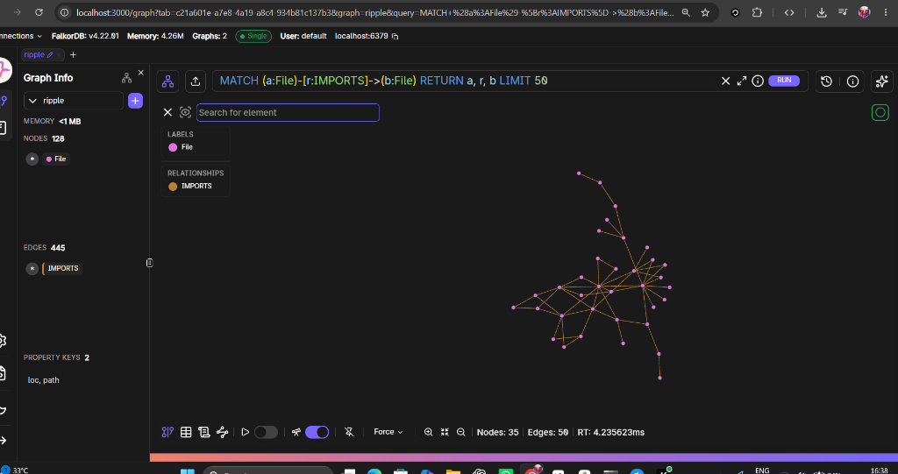
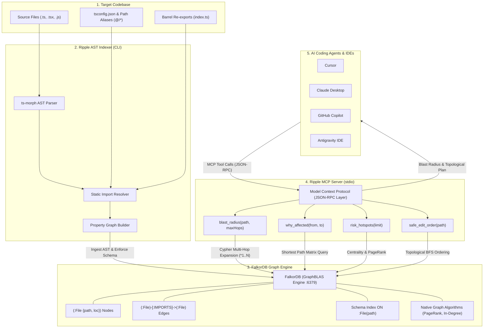

<div align="center">
  
  <h1>Ripple</h1>
  <p><strong>FalkorDB-Powered Dependency Graph & Blast Radius Intelligence for AI Coding Agents</strong></p>
  <p>
    <a href="https://ripple-graph.vercel.app"><strong>Live Website</strong></a> &bull;
    <a href="https://github.com/trivikramkalagi91-commits/Ripple"><strong>GitHub</strong></a> &bull;
    <a href="https://www.falkordb.com/"><strong>FalkorDB</strong></a>
  </p>
</div>

---

## The Problem: Coding Agents Break Code in the Dark
When AI coding agents (Claude, Cursor, Copilot, Antigravity) edit or refactor code in large codebases, they operate with a narrow view. A simple change to a core interface, utility function, or barrel export silently breaks consumers 2, 3, or 4 hops away.

Plain text search / grep cannot solve this:
- Re-exports and barrel files (`export * from './...'`) mask true dependency chains.
- Path aliases (`@/components`, `~/utils`) confuse simple directory searches.
- Common identifier names (`id`, `name`, `status`) generate thousands of false positive grep matches.

---

## The Solution: Ripple
**Ripple** is a high-performance Model Context Protocol (MCP) server powered by **FalkorDB**. It ingests a repository AST into a connected property graph:
- **Nodes**: `(:File {path, loc})`
- **Edges**: `(:File)-[:IMPORTS]->(:File)`
- Automatic resolution of `tsconfig.json` path aliases and barrel re-exports.

AI coding agents query Ripple *before* making changes to know the real blast radius, the exact shortest import chain, and the safe topological edit order.

<div align="center">
  
  <p><em>Force-directed dependency graph of 128 nodes and 445 edges running live in FalkorDB Browser</em></p>
</div>

---

## Architecture Overview

Ripple bridges static code analysis, low-latency graph databases, and LLM-powered coding agents via the Model Context Protocol (MCP):



### How the Pipeline Works:
1. **AST Ingestion (`cli.ts`)**: Parses TypeScript/JavaScript abstract syntax trees with `ts-morph`, resolves `tsconfig` paths and barrel exports, and generates a clean property graph.
2. **Graph Storage (`FalkorDB`)**: Stores files as `(:File)` nodes and imports as `(:File)-[:IMPORTS]->(:File)` directed edges with indexed paths for $O(1)$ lookups.
3. **MCP Tool Execution (`server.ts`)**: Runs Cypher queries through FalkorDB's GraphBLAS matrix traversal engine, resolving multi-hop paths in 3–5ms.
4. **Agent Action**: The coding agent queries Ripple before executing refactors, preventing regressions before modifying code.

---

## The 4 MCP Tools

| Tool | When AI Coding Agents Call It | What It Returns |
| :--- | :--- | :--- |
| **`blast_radius(path, maxHops=4)`** | **Before** editing, renaming, or modifying any function/type/component | All transitively affected files grouped by hop distance (1 to N) |
| **`why_affected(from, to)`** | When diagnosing how a change in `to` impacts a distant file `from` | The shortest direct import chain connecting the two files |
| **`risk_hotspots(limit=10)`** | When prioritizing tests or assessing architectural risk | Top files in the repo with highest incoming dependents (in-degree / PageRank) |
| **`safe_edit_order(path)`** | Before performing a multi-file refactor | Affected files ordered topologically by distance from target for safe incremental refactoring |

---

## First-Time User Setup Guide (3 Minutes)

Follow these 4 simple steps to get Ripple up and running:

### Step 1: Start FalkorDB
Ripple requires FalkorDB to store and query the dependency graph. Choose whichever option you prefer:

#### Option A: Local Docker (Recommended)
Run this single command to start FalkorDB and keep it running automatically in the background across reboots:
```bash
docker run -d --name falkordb --restart unless-stopped -p 6379:6379 -p 3000:3000 falkordb/falkordb:latest
```
- **Graph Database**: `localhost:6379`
- **Interactive Visual Browser**: [http://localhost:3000](http://localhost:3000) (select graph `ripple` to explore your codebase visually)

#### Option B: FalkorDB Cloud (No Docker needed)
If you don't use Docker, create a free instance at [app.falkordb.cloud](https://app.falkordb.cloud) and pass your host/password via environment variables.

---

### Step 2: Clone and Build Ripple
```bash
git clone https://github.com/trivikramkalagi91-commits/Ripple.git
cd Ripple
npm install
npm run build
```

---

### Step 3: Index Your Project Repository
Run the indexer pointing to the TypeScript or JavaScript codebase you want your AI agent to work on:
```bash
node dist/cli.js index C:/path/to/your/project
```
*Tip: You only need to run this command once (or when major architectural changes occur). Ripple will parse the AST, resolve all barrel files and `@/` aliases, and construct the graph in FalkorDB in seconds.*

---

### Step 4: Connect Ripple to Your AI Editor (MCP Configuration)
Add Ripple to your AI tool's MCP configuration file (e.g. Cursor, Claude Desktop, Antigravity IDE, or VS Code):

#### Cursor / Claude Desktop / Antigravity IDE (`mcp_config.json`)
```json
{
  "mcpServers": {
    "ripple": {
      "command": "node",
      "args": [
        "C:/path/to/Ripple/dist/server.js"
      ],
      "env": {}
    }
  }
}
```

#### Optional: Add the Agent Enforcement Rule
Add this to your project repository's `AGENTS.md` (or `CLAUDE.md` / `.cursorrules`):
```markdown
# Ripple Blast Radius Enforcement
Before modifying, renaming, or refactoring any exported function, type, or component,
you MUST invoke the `blast_radius` MCP tool on its file and ensure all downstream affected files are updated.
```

---

## How It Works In Practice
Once installed, **you don't have to run any CLI commands during your daily coding!**
1. You chat with your AI agent as usual:
   > *"Hey, please update `src/types/api.ts` to rename `id` to `entityId`."*
2. Your AI agent automatically checks the Ripple MCP tool behind the scenes:
   - It queries FalkorDB: `blast_radius('src/types/api.ts')`.
   - It sees that 58 downstream files across 4 hop distances depend on this type.
   - It updates the target file and all downstream consumers in `safe_edit_order` so nothing breaks!

---

## Optional: Inspecting & Querying from CLI (For Developers)
If you want to query the graph directly in your terminal without an AI:
```bash
# Calculate blast radius:
node dist/cli.js query blast_radius src/types/api.ts

# Trace the shortest dependency chain between two files:
node dist/cli.js query why_affected src/main.tsx src/utils/cn.ts

# List architectural risk hotspots:
node dist/cli.js query risk_hotspots

# Get safe topological edit order:
node dist/cli.js query safe_edit_order src/components/ui/button/button.tsx
```

---

## Project Info
- **Live Website**: [https://ripple-graph.vercel.app](https://ripple-graph.vercel.app)
- **Built by**: **Trivikram Kalagi** & **Suhas Hannamanavar**
- **Built with**: FalkorDB, TypeScript, ts-morph, @modelcontextprotocol/sdk
- **License**: MIT

---

<div align="center">
  <p>Built with ❤️ by <strong>Trivikram Kalagi</strong> and <strong>Suhas Hannamanavar</strong></p>
</div>

