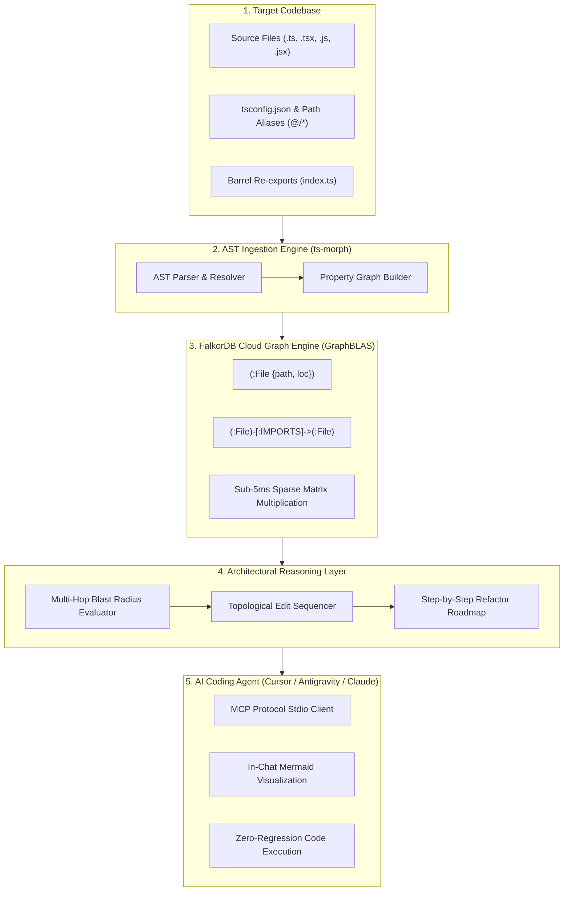

<div align="center">
  <p align="center">
    
    &nbsp;&nbsp;&nbsp;&nbsp;&nbsp;&nbsp;&nbsp;&nbsp;&nbsp;&nbsp;&nbsp;&nbsp;
    
  </p>
  <h1>Ripple</h1>
  <p><strong>FalkorDB-Powered Dependency Graph & Architectural Intelligence Guardian for AI Coding Agents</strong></p>
  <p>
    <a href="https://sarvam-ripple.embarko.app"></a>
    <a href="https://github.com/trivikramkalagi91-commits/Ripple"></a>
    <a href="https://www.falkordb.com/"></a>
  </p>
  <p>
    <a href="https://sarvam-ripple.embarko.app"><strong>🌐 Live on Embarko</strong></a> &bull;
    <a href="https://sarvam-ripple.vercel.app"><strong>🌐 Live on Vercel</strong></a> &bull;
    <a href="https://github.com/trivikramkalagi91-commits/Ripple"><strong>GitHub Repository</strong></a> &bull;
    <a href="https://www.falkordb.com/"><strong>FalkorDB</strong></a> &bull;
    <a href="https://modelcontextprotocol.io/"><strong>Model Context Protocol</strong></a>
  </p>
</div>

---

## ☁️ Instant Cloud Deployment via Embarko

Ripple is deployed directly on **[Embarko](https://embarko.ai)** (`#DeployWithEmbarko`), enabling zero-friction, containerless cloud hosting for developer tools:
- 🚀 **Live Production URL**: [https://sarvam-ripple.embarko.app](https://sarvam-ripple.embarko.app)
- ⚡ **Zero-Dockerfile Architecture**: Directly deploys modern frontend and web tools with zero container overhead or complex manifests.
- 🛡️ **Permanent & Claimed**: Authenticated, securely routed, and served via instant edge networking.

---

## 🚨 The Problem: AI Coding Agents Break Code in the Dark

When modern AI coding agents (Claude, Cursor, Copilot, Antigravity) edit or refactor code in medium-to-large repositories, they operate with dangerous **tunnel vision**. A single change to an exported function, interface, or shared utility silently breaks downstream consumers 2, 3, or 4 hops away.

Plain text search and `grep` fail completely:
- **Barrel re-exports** (`export * from './...'`) mask true dependency chains.
- **Path aliases** (`@/components`, `~/utils`) hide actual file paths on disk.
- **Common identifier names** (`id`, `user`, `status`) return hundreds of false-positive grep matches.
- **No topological ordering**: AI assistants don't know which order to edit files to avoid cascading build breakages.

---

## ⚡ The Solution: Ripple Architecture

**Ripple** is a high-performance Model Context Protocol (MCP) server that pairs **FalkorDB's** sub-5ms graph traversals with **deep architectural reasoning**:

1. **Deterministic Dependency Graph (FalkorDB)**: Ingests repository AST into a connected property graph of `(:File)` nodes and `[:IMPORTS]` edges with resolved path aliases and barrel files.
2. **Instant Visual Blast Radius**: Computes multi-hop blast radiuses in 3–5ms and renders an in-chat color-coded Mermaid diagram.
3. **Architectural Safe Plan**: Analyzes the affected files in topological sequence and writes an exact step-by-step code modification plan before any code is modified.
4. **Autonomous Zero-Regression Execution**: The AI coding agent applies the changes file-by-file without breaking builds or tests.



---

## ⚡ 1-Click Agent Setup Prompt (Copy & Paste Into Your AI Agent)

> **💡 Zero Manual Setup:** Copy the prompt below and paste it directly into your AI coding assistant (Cursor, Claude Desktop, or Antigravity). The agent will autonomously spin up FalkorDB, install Ripple, index your repository, and enforce graph-safety enforcement:

```text
Please install and set up Ripple for this workspace by performing the following steps:

1. Check FalkorDB availability:
   - Check if FalkorDB is reachable on localhost:6379.
   - If not reachable, check if Docker is installed and running (`docker ps`).
   - If Docker is running, start FalkorDB:
     docker run -d --name falkordb --restart unless-stopped -p 6379:6379 -p 3000:3000 falkordb/falkordb:latest
   - If Docker or FalkorDB is NOT installed on this machine, guide the user:
     "Neither Docker nor FalkorDB was detected locally. You have two instant options:
      Option A (Zero-install Cloud - Recommended): Create a free database in 30 seconds at https://app.falkordb.cloud (no Docker required). Share your Host, Port, and Password, and I will configure .env automatically!
      Option B (Local): Install Docker Desktop (https://www.docker.com) or install FalkorDB natively (`brew install falkordb/tap/falkordb` or `curl -fsSL https://www.falkordb.com/install.sh | bash`)."

2. Clone and build Ripple into a local helper folder:
   git clone https://github.com/trivikramkalagi91-commits/Ripple.git .ripple
   cd .ripple && npm install && npm run build && cd ..

3. Configure environment:
   In `.ripple/.env`, set:
   FALKOR_HOST=localhost (or your FalkorDB Cloud host)
   FALKOR_PORT=6379 (or your FalkorDB Cloud port)
   SARVAM_API_KEY=<your_api_key>

4. Index this repository into FalkorDB:
   node .ripple/dist/cli.js index .

5. Add the following rule to your instructions:
   "Before modifying, renaming, or refactoring any exported function, type, or component, you MUST consult Ripple's generate_safe_plan tool (or run `node .ripple/dist/cli.js plan <file> -c '<change>'`) to inspect the multi-hop blast radius and apply all edits in topological safe order so nothing breaks."

Confirm when setup and indexing are complete!
```

---

## 🛠️ MCP Tools Reference

Ripple exposes 5 specialized tools over the Model Context Protocol:

| Tool Name | Type | Description |
| :--- | :--- | :--- |
| **`generate_safe_plan`** | 🌟 **Flagship** | Computes multi-hop blast radius in FalkorDB, evaluates breaking changes with deep architectural reasoning, and returns the in-chat Mermaid diagram + topological safe edit plan. |
| **`blast_radius`** | Query | Returns all downstream dependent files up to $N$ hops with distance categorization. |
| **`why_affected`** | Query | Discovers the exact shortest import chain between two files (`(:File)-[:IMPORTS*]->(:File)`). |
| **`risk_hotspots`** | Query | Identifies the most critical files with the highest incoming dependency count across the repository. |
| **`safe_edit_order`** | Query | Returns the topological sequence ensuring base utilities are refactored before dependent consumers. |

---

## 🚀 Quickstart Guide (Local Development)

### 1. Configure `.env`
```env
SARVAM_API_KEY=your_api_key
SARVAM_MOCK=false
FALKOR_HOST=localhost # or your FalkorDB Cloud host
FALKOR_PORT=6379
FALKOR_USERNAME=falkordb
FALKOR_PASSWORD=your_password
FALKOR_GRAPH=ripple
```

### 2. Build and Index
```bash
npm install
npm run build

# Index any repository into FalkorDB:
node dist/cli.js index demo-repo
```

### 3. Generate a Safe Plan
```bash
node dist/cli.js plan demo-repo/src/types/api.ts -c "Rename field id to userId"
```

---

## 👥 License

MIT License. Open-source software designed to make AI coding agents safe, reliable, and regression-free.
